<picture>
  <source media="(prefers-color-scheme: dark)" srcset="docs/logo-dark.svg">
  
</picture>

# serio-focus

**Four specialist agents take a change from plan to pull request. Short replies, built for ADHD focus.**

architect · tester · coder · reviewer · a guard that asks before deletes git cannot undo

<!-- serio-demo -->

<!-- /serio-demo -->

[Agents](#agents) · [Install](#install) · [Safety net](#safety-net) · [Workflow](docs/WORKFLOW.md) · [Contributing](CONTRIBUTING.md)

## Agents

| Agent | Does | Returns |
|---|---|---|
| `architect` | Reads the code a goal touches and commits to the smallest approach. Edits nothing. | Plan: tasks, paths, a check per task, risks |
| `tester` | Writes one failing test through a public boundary, only when behaviour changes and the repository has tests. | Test path and its failing line |
| `coder` | Builds one planned task in a fresh context and runs the checks. Never commits. | Changed lines, check output, what was not done |
| `reviewer` | Reviews a diff in a fresh context. Edits nothing. | P0–P2 findings at `file:line`, verdict `ready` or `changes needed` |

| Skill | Run | Does |
|---|---|---|
| `deliver` | `/serio-focus:deliver <goal>` · Codex `$deliver` | Plan → red test → build → review → commit, push, pull request |
| `pr-loop` | `/serio-focus:pr-loop <PR>` · Codex `$pr-loop` | Clears failing checks and review threads until the head is clean |

## Replies

Every session starts with reply rules for an ADHD reader: result first, short bullets each with its why, one recommended action with its exact command.
Warnings and irreversible steps stay in full sentences.

## Safety net

| Call | What happens |
|---|---|
| `git commit`, `git push` | Run |
| Delete of tracked, clean files, a temp path or an ignored build folder | Runs: git or a rebuild restores it |
| Delete of untracked, modified or outside-repo data; `git reset --hard`; `git clean -f` | Claude asks you. Codex and OpenCode hold the call and show you the command |
| More than 3 direct subagent starts in 60 s | The next one waits for the next wave (`SERIO_MAX_PER_WAVE`, `SERIO_WAVE_MS`) |
| Every hold | One line in `audit/YYYY-MM.jsonl`, without the command text |
| Every turn end | One `session` line in the same file: project, branch, title, API calls, tokens, edited files; read from the transcript, no agent action |

The guard is a seatbelt, not a sandbox: [SECURITY.md](SECURITY.md).

## Install

1. `git clone https://github.com/serio-ngo/serio-focus.git && cd serio-focus`
   You should see `Cloning into 'serio-focus'`.
2. `npm run setup -- --host claude`, or `--host codex`
   You should see `Installed. Review and trust the hooks in the native host, then start a fresh session.`
3. Restart the host, then `npm run doctor -- --host claude`, or `--host codex`
   You should see every check answer `yes`.

Without a checkout, in Claude Code: `/plugin marketplace add serio-ngo/serio-focus`, then `/plugin install serio-focus@serio-ngo` and restart.

In Codex, setup also writes the four agents to `~/.codex/agents/`; open `/hooks` and trust the three Serio hooks after every update. After `git pull`, `claude plugin update serio-focus@serio-ngo` loads the new version in Claude Code. Never copy the checkout into the plugin cache by hand.

[CONTRIBUTING.md](CONTRIBUTING.md) · [SECURITY.md](SECURITY.md) · [docs/WORKFLOW.md](docs/WORKFLOW.md) · [docs/BENCHMARK.md](docs/BENCHMARK.md) · [docs/MANIFEST.md](docs/MANIFEST.md) · [docs/HOST_FACTS.md](docs/HOST_FACTS.md) · [Apache-2.0](LICENSE) · Built by [Serio NGO](https://serio.org.pl)

