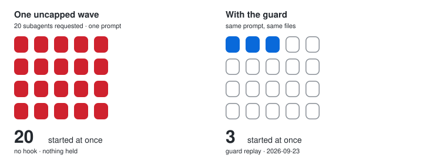
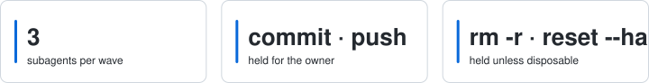

<picture>
  <source media="(prefers-color-scheme: dark)" srcset="docs/logo-dark.svg">
  
</picture>

# serio-focus

**An ADHD quality-of-life tool for Claude Code and Codex: less noise, more done.**

Three agents take a change from plan to pull request. 
Subagent floods capped · destructive commands held for the owner · every hold audited.

<!-- serio-demo -->

<!-- /serio-demo -->

[Start here](#start-here) · [What it does](#what-it-does) · [Workflow](docs/WORKFLOW.md) · [Proof](#proof) · [Method](docs/BENCHMARK.md) · [Contributing](CONTRIBUTING.md)

## Example

Claude Code and Codex can launch 20 subagents in one turn. A 5-hour window goes in seconds.

The hook caps each wave at 3 and queues the rest.

## Start here

1. `git clone https://github.com/serio-ngo/serio-focus.git && cd serio-focus`
   You should see `Cloning into 'serio-focus'`.
2. `npm run setup -- --host claude`, or `--host codex`
   You should see `Installed. Review and trust the hooks in the native host, then start a fresh session.`
3. Restart the host, then `npm run doctor -- --host claude`, or `--host codex`
   You should see every check answer `yes`.

Without a checkout, in Claude Code: `/plugin marketplace add serio-ngo/serio-focus`, then `/plugin install serio-focus@serio-ngo` and restart.

In Codex, setup also writes the three agents to `~/.codex/agents/`; open `/hooks` and trust the two Serio hooks after every update. After `git pull`, `claude plugin update serio-focus@serio-ngo` loads the new version in Claude Code. Never copy the checkout into the plugin cache by hand.

## What it does

| Guard | Notes |
|---|---|
| Fan-out cap | `SERIO_MAX_PER_WAVE=3`, `SERIO_WAVE_MS=60000`: the fourth direct `Agent`, `Task` or `spawn_agent` call in a wave waits for the next one. Workflow scripts are not parsed. |
| Git lock | `git commit` and `git push` are held for the owner, nested shells included; the reason names the exact command. Reads, branches, stashes and merges run. `SERIO_GIT_WRITE=1` reopens commit and push. |
| Delete lock | Recursive deletes, `git clean -f` and `git reset --hard` are held unless every target is a literal path inside the temp dir, `SERIO_SCRATCH_DIR` or an ignored build folder. Tracked files and symlink escapes stay held. |
| Audit | Every hold appends one line to `audit/YYYY-MM.jsonl`: session, agent, tool, target, rule. |
| Session card | One startup line names the holds. |

| Agent | Notes |
|---|---|
| `architect` | Read-only planner: one approach, tasks with paths and checks. |
| `coder` | Builds one planned task in a fresh context, runs the checks, never commits. |
| `reviewer` | Read-only review of a diff: P0–P2 findings at `file:line`, verdict `ready` or `changes needed`. Applies Ponytail review when installed. |
| `tester` | Draft, disabled: failing test first. Move `plugins/serio-focus/drafts/tester.md` to `agents/` to enable. |
| `deliver`, `pr-loop` | Skills that run the agents from plan to pull request, then clear failing checks and review threads, Codex findings included. |

Every guard blocks first and suggests second. No block is a refusal — each names the override above
or the command to run yourself, and the owner decides.

## Proof

Every case is labelled in `tooling/corpus/guard-corpus.jsonl` and re-scored by every `npm test` and in CI.
Method, last result and limits: [docs/BENCHMARK.md](docs/BENCHMARK.md).

[CONTRIBUTING.md](CONTRIBUTING.md) · [SECURITY.md](SECURITY.md) · [docs/WORKFLOW.md](docs/WORKFLOW.md) · [docs/BENCHMARK.md](docs/BENCHMARK.md) · [docs/MANIFEST.md](docs/MANIFEST.md) · [docs/HOST_FACTS.md](docs/HOST_FACTS.md) · [Apache-2.0](LICENSE) · Built by [Serio NGO](https://serio.org.pl)

